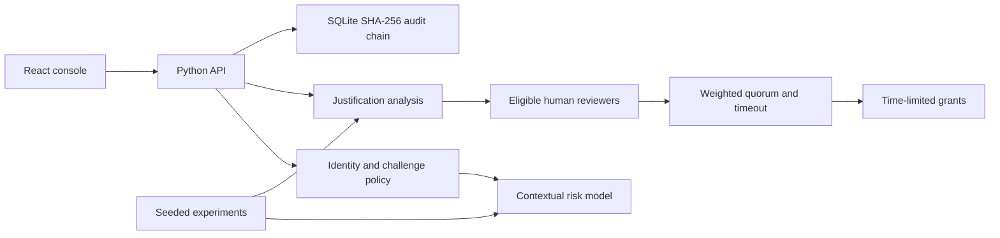

# Architecture

Adaptive IAM implements two connected decisions: whether a login should proceed, and whether a verified identity may temporarily access a resource. The frontend makes decisions visible; the backend is authoritative.

## Decisions and boundaries

Risk scores live in `[0, 1]`. The paper baseline uses 0.3/0.7 boundaries. The deployed candidate selects its low challenge boundary using validation data only: the largest threshold meeting an 80% suspicious-detection target; the high boundary remains 0.7. Read the current boundaries from `/api/bootstrap`, rather than hardcoding paper cutoffs. Binary experiment classification uses a separate threshold, so its accuracy/recall is not authentication challenge/block recall. Inference is distinct from policy: a low score does not override mandatory safety checks. Resource requests recompute risk from stored login context plus server-owned resource sensitivity.

TF-IDF/Naive Bayes provides the paper text baseline. Improved text features and confidence handling may route ambiguity to review. An optional locally configured BERT classifier must have task-specific labels; a generic sentiment model is not an authorization model.

Review selection is deterministic by default. Optional Ollama suggestions are constrained to eligible organizational reviewers, with a deterministic fallback. Every request requires human review, regardless of the NLP label. The requester cannot vote on their own request. Owner weight is 1.5, other reviewer weight is 1.0. Approval requires a strict majority of the selected reviewers' total possible weight, at least two votes, and resource owner approval; an owner denial vetoes the request. Uncast votes must not shrink that denominator. The default review timeout is 48 hours. These owner/quorum requirements deliberately strengthen the paper's simple weighted-majority proposal.

Timed grants are checked at access time. Expiry enforcement must not rely only on a UI countdown or a background cleanup process.

Registered websites use Authorization Code with PKCE. The provider issues RS256 identity tokens and separate opaque, client-bound application access tokens. The relying-party server verifies identity and checks the app's registered resource allowlist plus the subject's live grant before protected content. Console sessions and app tokens have distinct authority. [INTEGRATION.md](INTEGRATION.md) explains the complete flow.

Audit blocks use canonical event serialization and previous hashes. Verification detects retained chain mutation. An administrator able to rewrite the entire database can reconstruct a consistent chain; external checkpoints or a distributed ledger are future work.

## Layout

| Path | Responsibility |
| --- | --- |
| `backend/` | API, models, security policy, storage and tests |
| `frontend/` | Responsive console, accessibility and dark/light themes |
| `integrations/` | OIDC relying-party SDKs, protected website examples and tests |
| `experiments/` | Dataset generation, model evaluation and result artifacts |
| `research/` | Original research assets |
| `docs/` | Design decisions, evidence, operations and API guide |
| `scripts/` | Setup, verification and compact agent context |
| `.codex/` | Reviewable project agent and lifecycle hook configuration |
