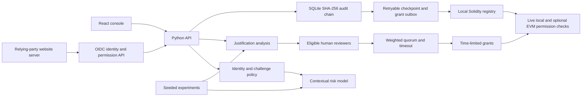

# Architecture

Adaptive IAM implements two connected decisions: whether a login should proceed, and whether a verified identity may temporarily access a resource. The frontend makes decisions visible; the backend is authoritative.

## Decisions and boundaries

Risk scores live in `[0, 1]`. The paper baseline uses 0.3/0.7 boundaries. The deployed candidate selects its low challenge boundary using validation data only: the largest threshold meeting an 80% suspicious-detection target; the high boundary remains 0.7. Read the current boundaries from `/api/bootstrap`, rather than hardcoding paper cutoffs. Binary experiment classification uses a separate threshold, so its accuracy/recall is not authentication challenge/block recall. Inference is distinct from policy: a low score does not override mandatory safety checks. Resource requests recompute risk from stored login context plus server-owned resource sensitivity.

TF-IDF/Naive Bayes provides the text baseline with a validation-selected decision threshold. The word/character TF-IDF logistic candidate remains reported but is rejected by its validation gate. Runtime analysis abstains when class support is below 0.65 and can flag explicit bypass language separately; binary experiment scores exclude those abstentions/flags. An optional locally configured BERT classifier must have task-specific labels; a generic sentiment model is not an authorization model.

Review selection is deterministic by default. Optional Ollama suggestions are constrained to eligible organizational reviewers, with a deterministic fallback. Every request requires human review, regardless of the NLP label. The requester cannot vote on their own request. Owner weight is 1.5, other reviewer weight is 1.0. Approval requires a strict majority of the selected reviewers' total possible weight, at least two votes, and resource owner approval; an owner denial vetoes the request. Uncast votes must not shrink that denominator. The default review timeout is 48 hours. These owner/quorum requirements deliberately strengthen the paper's simple weighted-majority proposal.

Timed grants are checked at access time. Expiry enforcement must not rely only on a UI countdown or a background cleanup process.

Real-log research follows a separate offline path: bounded public acquisition, past-only feature history, warmup-only estimator fitting, chronological validation search, later test and frozen aggregate publication. The API displays those aggregates without loading their fitted artifacts. [The training guide](REAL_AUTH_TRAINING.md) records every candidate and regression. Trained research estimators do not participate in live authorization.

Registered websites use Authorization Code with PKCE. The provider issues RS256 identity tokens and separate opaque, client-bound application access tokens. The relying-party server verifies identity and checks the app's registered resource allowlist plus the subject's live grant before protected content. Console sessions and app tokens have distinct authority. [INTEGRATION.md](INTEGRATION.md) explains the complete flow.

Audit blocks use canonical event serialization and previous hashes. Verification detects retained chain mutation. An administrator able to rewrite the entire database can reconstruct a consistent local chain.

[Audit inclusion proofs](AUDIT_PROOFS.md) supplement that chain with append-only SQLite batch manifests and RFC 9162-style domain-separated Merkle trees over sequence/hash leaves. A security reviewer seals up to 256 contiguous events from one verified snapshot, exports hash-only inclusion bundles, and can explicitly anchor/check the root against the optional EVM registry. Live checks bind roots to the already anchored per-event prefix; portable verification needs an independently trusted expected root. The original event/grant checks remain authoritative. This adds an audit proof index, rather than pruning history or establishing independent administrator trust.

The optional Web3 adapter anchors event hashes and timed, hashed identity/resource grants in `AccessGrantRegistry.sol` on Ganache chain 31337. A retryable SQLite outbox distinguishes pending transactions from confirmed receipts. A grant is mirrored only after its creation event has been anchored and the actual human owner/quorum still validates. Protected console access and website permission responses require a live contract grant alongside the local grant when Web3 is configured. Unavailable RPC, incompatible registry, checkpoint mismatch, expiry and revocation deny access. Owner/security-reviewer revocation removes local authority immediately, with chain synchronization retried separately.

Docker keeps chain/deployer services on an internal bridge with no published RPC, non-root users, read-only root filesystems and restricted privileges. Web services also join an edge bridge for Docker Desktop port publishing; it permits their outbound traffic. The console/API ports bind only to loopback. The chain is a local EVM implementation with a trusted writer and one administrative host; independent-node consensus and resilience are unestablished. See [deployment operations](../deployment/README.md).

## Layout

| Path | Responsibility |
| --- | --- |
| `backend/` | API, models, security policy, storage and tests |
| `frontend/` | Responsive console, accessibility and dark/light themes |
| `integrations/` | OIDC relying-party SDKs, protected website examples and tests |
| `blockchain/` | Solidity registry, Ganache scripts and EVM behavior tests |
| `deployment/` | Docker containers, Nginx and operation notes |
| `experiments/` | Dataset generation, model evaluation and result artifacts |
| `research/` | Original research assets |
| `docs/` | Design decisions, evidence, operations and API guide |
| `scripts/` | Setup, verification and compact agent context |
| `.codex/` | Reviewable project agent and lifecycle hook configuration |

## Identity and application lifecycle

The Security workspace verifies actual passkey signatures, TOTP and recovery codes. Server-observed IP/User-Agent changes and recorded password-failure spikes gate sessions; app tokens depend on their originating console session. Private first login and last-factor removal create an enrollment-only five-minute session. [AUTHENTICATION.md](AUTHENTICATION.md) describes the precise trust limits and secure-mode provisioning.

Organizations scope app managers and eligible app subjects, and current resource-owner membership is rechecked alongside live grants. Prototype identities/resources remain shared infrastructure; organization creation is not a full tenant-isolation boundary. Confidential secret rotation revokes tokens and pending authorizations. Callback diagnostics inspect syntax/exact registration without fetching arbitrary hosts.

The Attack lab executes bounded simulated contexts and observes actual runtime models and existing actor-owned permission state. It records the latest 20 results per actor without creating sessions, requests, votes or grants. It is a diagnostic tool, not attack ground truth.

For consensus experiments, [QBFT](WEB3_NETWORK.md) adds four Besu validators, a constrained isolated signer and three-validator freshness/agreement requirements. Every validator is local to one administrative host; measured crash resilience is distinct from independently operated Byzantine security.
