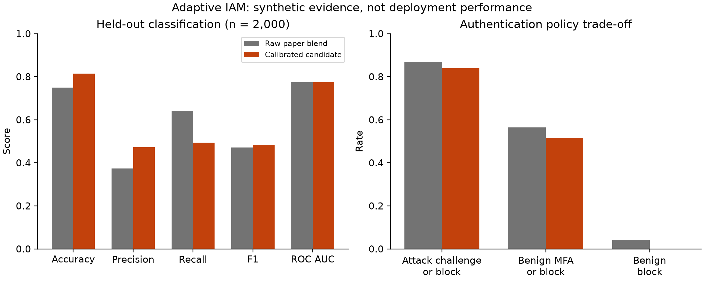
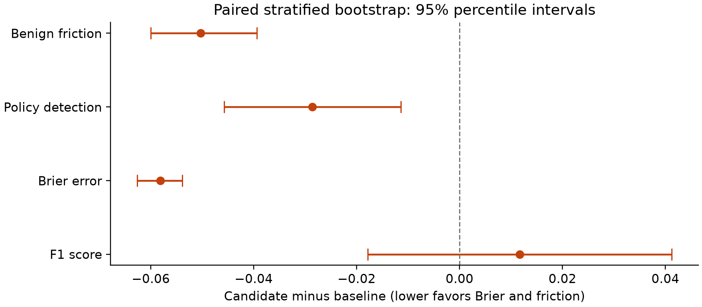
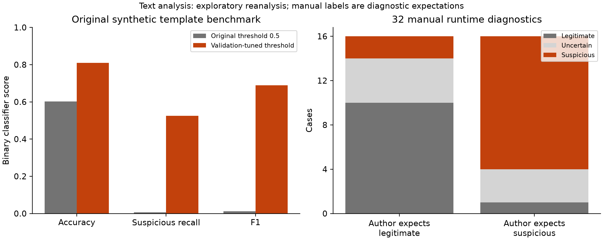
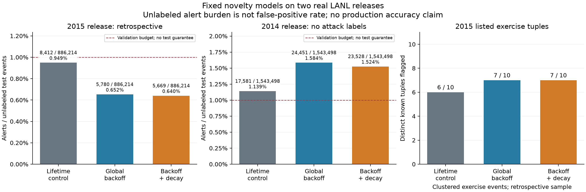
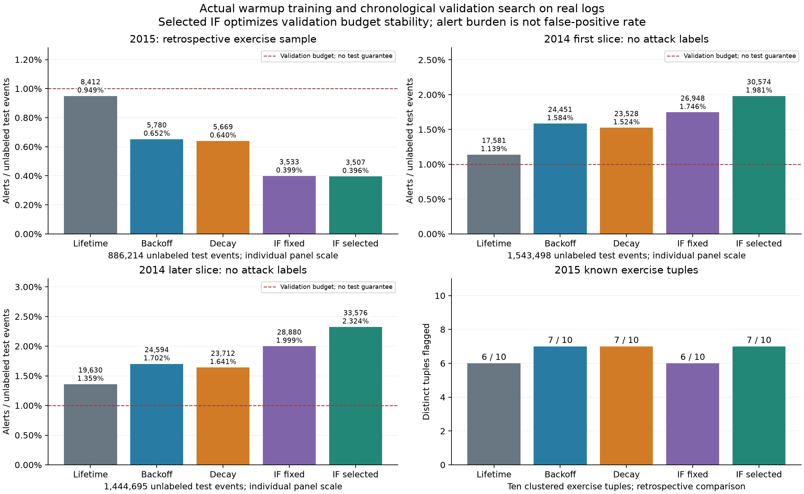

# Adaptive IAM: Evaluating calibrated authentication policy and human-reviewed authorization with local EVM grants

**Research manuscript draft — updated 13 October 2026. Authors and affiliations: to be confirmed.** This draft reports the checked-in simulation artifacts, public creator-synthesized sample and implementation, not production deployment results. Original supplied papers and reports remain unchanged. Bibliography: [references.bib](references.bib); supporting reading notes: [verified readings](../../research_notes/Adaptive%20IAM%20evidence%20study/readings.md).

## Abstract

Adaptive authentication combines probabilistic risk estimates with decisions that affect both attack detection and legitimate-user burden. We implement an Adaptive IAM research prototype that separates contextual authentication from human-reviewed resource authorization and exposes those decisions through an OAuth/OIDC website integration. An optional Solidity registry anchors audit hashes and time-limited grants; permission checks require live local and contract authority. On 10,000 seeded synthetic login events, a validation-selected sigmoid-calibrated logistic-regression/random-forest blend reduces held-out Brier loss from 0.1747 to 0.1165 and legitimate-user challenge/block friction from 56.48% to 51.45%, while suspicious detection decreases from 86.86% to 84.00%. Five complete retraining controls subsequently isolate calibration: mean Brier loss improves from 0.1807 to 0.1134, but equally tuned raw/calibrated decisions and ranking remain identical. A 200,000-event public creator-synthesized sample has only three takeover-positive rows and is ineligible for takeover evaluation; Attack-IP proxy studies disclose a user-disjoint F1 regression. Exploratory text reanalysis and translated author diagnostics establish neither independent language generalization nor verified attack truth. Passkey/TOTP verification and source-session-bound website tokens strengthen implemented controls; four local QBFT validators demonstrate crash-outage behavior. Physical-authenticator usability, organizational telemetry, independent human labels, protocol certification and independently administered Byzantine resilience remain unestablished. ([Original results](../../experiments/results.json), [Retraining controls](../../experiments/risk-protocol.json), [Public sample study](../../experiments/external-study.json), [Language diagnostics](../../experiments/multilingual-results.json), [QBFT study](../../experiments/qbft-results.json))

**Keywords:** risk-based authentication; identity and access management; calibration; human authorization; OpenID Connect; Solidity; reproducibility.

## 1. Introduction

The supplied project reports motivate a combined pipeline of contextual risk, natural-language justification, human voting and auditable timed permission. This implementation makes the proposal executable while replacing unsupported accuracy projections and broad blockchain guarantees with measured artifacts and explicit trust boundaries. The research questions are whether calibration changes classification and authentication policy differently, whether a validation detection target transfers to fresh test events, and how identity, reviewer authority and grant enforcement can be composed without allowing an advisory model to grant access. ([Supplied report extract](../research/report-final.txt), [Implementation research map](../RESEARCH.md))

NIST's zero-trust architecture separates authentication and authorization and emphasizes resource-specific decisions. This motivates a login decision followed by an independent, expiring resource grant. It does not establish NIST compliance for the prototype. ([NIST SP 800-207](https://csrc.nist.gov/pubs/sp/800/207/final))

Our contribution is a reproducible implementation and exploratory evaluation: an explicit authority boundary, distinct classification and authentication thresholds, matched calibration controls across full fits, retained rejected candidates, external label-eligibility checks and live local EVM failure-state enforcement. We make no first-system or universal superiority claim.

## 2. Related work and standards

Wiefling and colleagues analyze RBA configurations using large-scale service data and provide a synthesized corpus. Their work motivates service-specific historical evaluation and detection/friction reporting; this project does not reproduce their original service measurements. The author manuscript dates to 2022, with the final TOPS volume listed in 2023. ([Primary study](https://arxiv.org/html/2206.15139v2), [Bibliographic metadata](https://arxiv.org/abs/2206.15139))

LLMAC demonstrates LLM-based policy reasoning and reports 98.5% accuracy on its own synthetic scenarios. The different task, model and label construction prevent direct numerical comparison with our login or justification experiments. We retain language models as constrained advisers. ([Zisad and Hasan, 2026](https://arxiv.org/abs/2602.09392))

OAuth security guidance and PKCE motivate exact callbacks, transaction-bound code redemption and confidential-client protection. OIDC supplies ID-token identity semantics, including issuer, audience, expiry and nonce validation. Our provider implements a limited code-flow subset and is not certified for complete conformance. ([RFC 7636](https://www.rfc-editor.org/info/rfc7636/), [RFC 9700](https://www.rfc-editor.org/info/rfc9700/), [OIDC Core](https://openid.net/specs/openid-connect-core-1_0.html))

Connectivity novelty has prior statistical foundations: Heard and Rubin-Delanchy [15] model authentication-network connections and discuss nonexhaustive exercise labels. The later backoff/decay extension here is a simpler marginal novelty baseline, not a replication of their Dirichlet-process model or an algorithmic novelty claim.

## 3. System and threat boundary

The React console submits bounded inputs to a FastAPI service backed by SQLite. The service verifies password credentials, stores hashed opaque sessions, enforces risk challenges and locks repeated failures. Public bootstrap credentials and displayed challenge codes remain explicit demo fixtures. Enrolled identities instead require cryptographically verified passkeys, TOTP or single-use recovery codes. Secure mode rejects the public seed password, ignores tester-selected context and confines first private login to factor enrollment. Server-observed address/User-Agent changes and durable password-failure spikes require renewed factor verification; source-session expiry, revocation or step-up denies website-token authority. These partial anomaly signals are not trusted device telemetry. Software-authenticator tests verify signatures and failure states but do not establish physical-device usability or operational assurance. ([API](../API.md), [Verified authentication](../AUTHENTICATION.md), [Security boundary](../SECURITY.md))

Each resource request uses the session identity and server-selected eligible reviewers. The owner has weight 1.5; each other reviewer has weight 1.0. For eligible set R and approving set A, approval requires an owner approval, at least two submitted votes and:

$$\sum_{r\in A}w_r > \frac{1}{2}\sum_{r\in R}w_r.$$

The denominator includes uncast reviewer weight. Owner denial vetoes; unresolved requests expire after 48 hours. The requester cannot self-vote. LLM output must satisfy reviewer eligibility and falls back to deterministic selection when invalid or unavailable. No model output can replace these checks. Approval expresses business authorization, not an attack label. ([Server policy](../../backend/app/store.py), [Architecture](../ARCHITECTURE.md))

The relying-party website registers exact callbacks, scopes and resource IDs, then performs Authorization Code with S256 PKCE. The website holds state, nonce, verifier, access token and confidential secret on its server, with random HttpOnly cookie keys identifying its sessions. It validates signed identity and calls a client/subject/resource-bound permission endpoint before each protected response. Login consent supplies no resource grant and website tokens carry no console authority. ([SDKs and examples](../INTEGRATION.md))

The SQLite audit log chains canonical SHA-256 event hashes. Optional `AccessGrantRegistry.sol` receives hash checkpoints and hashed subject/resource grants from a trusted writer on chain 31337. The retryable outbox mirrors grants only after anchored creation and verified owner/quorum. Live checks require local grant validity and the corresponding contract grant, denying on RPC failure, mismatch, expiry or revocation. Revocation removes local authority immediately even while chain synchronization is pending. This is real local contract execution; a single local administrator still controls its chain and host. ([Solidity contract](../../blockchain/contracts/AccessGrantRegistry.sol), [Web3 adapter](../../backend/app/blockchain.py))

The Docker stack keeps Ethereum RPC on an internal bridge and uses non-root users, read-only root filesystems, dropped capabilities and process/memory limits. Web services also join an edge bridge, which permits their outbound traffic. Console/API and optional website ports publish only on host loopback. Persistent IAM and chain state must remain consistent. These settings reduce exposed runtime surfaces; they do not establish independence from the host administrator or production isolation. ([Compose](../../compose.yaml), [Operations](../../deployment/README.md))

An optional four-validator Besu QBFT installation replaces the Ganache development chain for separate consensus experiments. Distinct validator keys and an authenticated isolated signer constrain writes to the registry's checkpoint, grant and revoke operations; the API holds no writer key. Live access additionally requires three responsive validators agreeing on a recent common block. All four containers still share one host and administrator, and the signer's encrypted keystore password co-resides in its volume. This is a measured local crash-resilience boundary, not independently administered Byzantine security or HSM protection. ([Network and signer boundaries](../WEB3_NETWORK.md))

## 4. Experimental method

### 4.1 Synthetic login generation and partitions

The main dataset uses seed 20261009 and 10,000 events with ten normalized features: device unfamiliarity, location unfamiliarity, VPN use, failures, hour deviation, login velocity, account youth, travel distance, resource sensitivity and prior risk. Bernoulli, Poisson, beta and uniform generators construct the features. The latent logit contains linear terms and device/location and VPN/hour interactions. Labels are sampled as:

$$p(y=1\mid x)=0.015+0.97\,\sigma(z(x)),\qquad y\sim\mathrm{Bernoulli}(p).$$

The stochastic labels are not copied from runtime policy thresholds. Their construction still shares a designed relationship with the input features and does not reproduce real attack behavior. A seeded permutation produces a 6,000 training, 1,000 calibration, 1,000 selection and 2,000 test split. Suspicious prevalence in the test partition is 17.5%. Learned preprocessing fits only training data. ([Generator and training code](../../backend/app/risk.py), [Results protocol](../../experiments/results.json))

### 4.2 Models, calibration and threshold selection

The paper-inspired baseline is:

$$s(x)=0.4\,P_{LR}(y=1\mid x)+0.6\,P_{RF}(y=1\mid x).$$

Logistic regression uses standardized features, balanced class weights, C=0.7 and a 400-iteration cap. The forest has 100 trees, depth 10, minimum leaf size 12 and balanced weights. Pairwise interaction features are retained only if selection-partition ROC-AUC improves; they are rejected in the current artifact. A logistic sigmoid fitted to the raw probability logit on the calibration partition is retained only after selection-partition Brier loss improves. ([Risk implementation](../../backend/app/risk.py))

Classification uses the highest maximum-F1 selection threshold from a fixed 0.05–0.75 grid. Authentication policy uses a separately selected low challenge threshold meeting at least 80% suspicious detection on validation, with high block threshold 0.7. The implementation selects from the lower empirical suspicious-score quantile with a conservative floating-point boundary. Test data does not select these settings. The baseline classification threshold is 0.5 and its policy thresholds are 0.3/0.7. ([Recorded method](../../experiments/results.json))

For probability p, policy detection and legitimate friction are:

$$D=P(p\geq t_L\mid y=1),\qquad F=P(p\geq t_L\mid y=0).$$

Direct suspicious allowance is 1-D; benign high-risk blocking is P(p≥t_H | y=0). These differ from binary classification recall at threshold t_C. Brier loss is the mean squared probability error. It combines reliability and discrimination, so its reduction alone does not prove better calibration. ([Metric implementation](../../backend/app/risk.py), [Calibration reference](https://scikit-learn.org/stable/modules/calibration.html))

### 4.3 Conditional robustness and fresh candidate study

The bootstrap resamples the same test events in paired, class-stratified fashion for 1,000 repetitions, seed 20261109. It preserves each model's prediction pairing and reports percentile 95% intervals. Five independently generated 2,000-event batches test the frozen model without refitting. The independent candidate study uses seed 20261509, 12,000 events and a 7,200/1,200/1,200/2,400 split. It selects among calibrated blend, unweighted interaction logistic regression and histogram gradient boosting through validation Brier, ranking and friction/detection constraints, then records every test outcome. It does not replace the deployed model. ([Robustness protocol](../../experiments/robustness.json), [Candidate protocol](../../experiments/candidate-study.json))

### 4.4 Justification benchmark and environment

The text study generates 2,000 requests with disjoint template groups across 1,200 training, 400 validation and 400 test texts. The original TF-IDF/Multinomial Naive Bayes threshold-0.5 result is retained. An exploratory reanalysis selects the threshold maximizing validation macro F1 and compares a fixed-C=0.8 balanced logistic model with word/character TF-IDF. The new model is retained only if it improves validation macro F1 without increasing legitimate flagging. Only two template groups per label are held out, and their outcomes were already reported before this reanalysis. Runtime class support below 0.65 produces abstention; binary scores exclude abstentions, lexical flags and BERT. Every request still needs human authorization. Recorded analysis environment is Python 3.11.9, NumPy 2.4.6 and scikit-learn 1.9.1 on Windows. Hardware details are insufficient for hardware-normalized latency claims. ([Text method](../../backend/app/nlp.py), [Results](../../experiments/results.json), [Environment](../../experiments/robustness.json))

### 4.5 Additional attribution and eligibility controls

Seeds 20261020–20261024 each generate 10,000 new events and fully refit the 6,000/1,000/1,000/2,000 training/calibration/selection/test protocol. Both probability representations receive identical exact validation-score F1 tuning and the raw paper policy's validation detection target. Mapping the raw 0.7 high cutoff through the retained positive-slope sigmoid isolates block decisions. Ten fixed equal-width reliability bins, per-fit values, sample standard deviations and ranges separate probability estimates from operating-point changes. No test outcome selects a runtime replacement. ([Full retraining protocol](../../experiments/risk-protocol.json))

The public study uses a 200,000-row convenience prefix of the creators' synthesized RBA corpus, with recorded sample SHA-256 and CC BY 4.0 provenance. Bounded acquisition does not verify the complete archive checksum or CSV-member CRC. Past-only historical features exclude current labels/outcomes; chronological 60/10/10/20 and deterministic user-disjoint cohorts are evaluated separately. Every partition must contain both label classes before fitting. Attack-IP proxy labels remain distinct from account takeover. Eighteen translated author diagnostics span six shared semantic groups; a frozen blind annotation workflow supports at least two named human attestations and disagreement adjudication, but independent human collection remains pending. The new Python artifacts record their Linux container software environment separately from the earlier Windows results. ([Acquisition manifest](../../experiments/external-data.json), [External protocol](../../experiments/external-study.json), [Language protocol](../../experiments/multilingual-results.json), [Annotation requirements](../ANNOTATION.md))

### 4.6 Later uncertainty and shift protocol extension

A separately fixed protocol (20 October; measurements completed 21 October 2026) refits five new seed identifiers, 20261101–20261105, on disjoint 6,000 training / 1,000 probability calibration / 1,000 selection / 2,000 conformal calibration / 2,000 IID test rows. The base LR/RF family is unchanged. Nonconformity is one minus true-label probability, with the finite-sample rank `ceil((n+1)(1-alpha))`, alpha 0.1, and conservative full inclusion for unavailable ranks. Marginal and class-conditional sets are established methods [11]. A gate may directly allow only a baseline-allowed event whose set is exactly `{legitimate}`; it can only add verification. Four prespecified conditions cover IID, feature-only remote-work rejection sampling, paired 50% telemetry masking, and pure label-prevalence rejection sampling. Shifted test labels never fit probabilities, thresholds or quantiles. No result selects a deployed replacement. Unweighted coverage claims require corresponding exchangeability assumptions; the weighted covariate-shift correction [12] is not implemented. ([Complete protocol](../UNCERTAINTY_STUDY.md), [Frozen artifact](../../experiments/uncertainty-study.json))

### 4.7 Real enterprise log extension

The later LANL extension uses deidentified enterprise authentication from Kent's 2015 dataset [13], obtained from its open institutional mirror with bounded byte/time acquisition. It retains human-source LogOn events, groups equal timestamps, and uses only earlier-second user/source, user/destination and edge-frequency counts. Source-time windows allocate 50% warmup, 25% validation and 25% test. Tied-score thresholds use no labels and permit at most 1% validation alerts. Reference matching uses exact time/user/source/destination tuples, with recall over distinct tuples rather than duplicate authentication rows. The prefix endpoint was informed by a public exercise example for feasibility; this is disclosed targeted sampling. Unlisted events remain unlabeled, precluding accuracy, precision, false-positive rate and AUROC claims. ([Acquisition and protocol](../LANL_STUDY.md), [Measured aggregate](../../experiments/lanl-study.json))

### 4.8 Fixed backoff/decay models on a second real release

The user/computer comparison fixes three models before computing their results: lifetime count surprise, smoothed global backoff and the same backoff with a one-day exponential half-life. With strictly earlier-second counts, `pG=(global computer count+1)/(global event count+2)` and `pU=(user/computer count+8*pG)/(user count+8)`; the backoff score is `-ln(pU)`. This is a marginal propensity score, not a categorical likelihood or attack probability. All relevant counts decay to the same timestamp. A fixed 0.001 score-bin width bounds calibration memory; conservative tied-score thresholds use at most 1% validation alerts. Shared lifetime history defines cold-user, known-user/new-computer and familiar-pair strata. No labels enter features, history or threshold fitting.

The 2014 LANL user/computer release [14] supplies a fixed 16 MiB compressed prefix with successful events and no attack labels, supporting burden and cold-start analysis only. The already-inspected 2015 prefix is a retrospective diagnostic, preserving exact exercise tuples and reporting all fixed models regardless of outcomes. Both datasets originate from LANL, with undisclosed collection dates; different releases do not establish organizational or temporal independence. The runtime contextual LR/RF model is unchanged because these log fields and sparse labels do not validate its feature schema. ([Frozen protocol and results](../REAL_AUTH_MODELS.md), [Additional acquisition](../LANL2014_STUDY.md))

### 4.9 Learned real-log models and chronological parameter search

The training extension fits Isolation Forests [16] on three bounded real-log slices, with a seeded uniform reservoir of at most 30,000 warmup feature vectors per slice. Nine strictly past-second features describe normalized user/global, pair/user and computer/global frequency, observed event rate, user destination diversity, cold-user/pair indicators and capped recencies. Relative features replace raw cumulative counters before any results are computed, reducing a trivial elapsed-history proxy without assuming stationarity. All candidate estimators use 100 trees, seed 20261021 and identical reservoirs/features. The six-configuration grid crosses `max_samples={128,256,512}` with `max_features={0.75,1.0}`; the fixed control uses 256 and 1.0.

Warmup/validation/test retain the 50/25/25 source-time split and complete timestamp groups. Validation's first half selects a conservative 1% score threshold per candidate; its later half selects the smallest absolute alert-budget deviation, with unsupported/disabled candidates excluded and deterministic ties. The selected threshold is then recalibrated on all validation and frozen before test. This objective is operational budget stability, not attack detection accuracy. No labels enter fitting or selection. Test scores are floored to the fixed 0.0001 resolution. Every fitted artifact, reservoir tensor, selected stream partition and executed source has a recorded hash. The new later monthly prefix supplies 4,970,690 usable events from a nonoverlapping relative-time interval of the same 2014 release. ([Complete training/model card](../REAL_AUTH_TRAINING.md), [Additional slice](../LANL_MONTH01.md))

### 4.10 Supplemental audit inclusion evidence

The storage extension commits contiguous verified audit prefixes of at most 256 events to append-only SQLite batch manifests. It applies RFC 9162 tree construction [17] to the custom leaf input `uint64_be(sequence) || audit_event_hash`, with distinct leaf/internal hash domains and unbalanced tree shape; it does not implement Certificate Transparency's TLS protocol. An authenticated security reviewer can export a hash-only inclusion bundle and explicitly anchor/check its root in the optional local EVM registry. The contract requires contiguous batch ranges, the previous root and an already anchored legacy audit end hash. Offline verification separates inclusion from independently trusted root matching. Existing grant/quorum enforcement and per-event anchors remain in place. This is a proof index, without a transaction-cost or decentralized-trust claim. ([Construction and threat model](../AUDIT_PROOFS.md))

## 5. Results

### 5.1 Classification and probability error

| Held-out metric | Raw paper blend | Calibrated candidate |
| --- | ---: | ---: |
| Accuracy | 74.90% | 81.50% |
| Suspicious precision | 37.33% | 47.27% |
| Suspicious recall | 64.00% | 49.43% |
| F1 | 0.471579 | 0.483240 |
| ROC-AUC | 0.774324 | 0.774324 |
| Brier loss | 0.174673 | 0.116540 |
| Classification threshold | 0.50 | 0.26 |

Source: [main held-out artifact](../../experiments/results.json). The majority baseline achieves 82.50% accuracy and zero suspicious recall. Thus the candidate's increased accuracy does not establish uniformly improved attack detection. The unchanged ROC-AUC is consistent with the retained model and monotonic calibration.

### 5.2 Authentication policy and rejected ablation

| Held-out policy metric | Raw 0.3/0.7 | Candidate 0.10533/0.7 | Rejected calibrated 0.3/0.7 |
| --- | ---: | ---: | ---: |
| Suspicious challenge/block recall | 86.86% | 84.00% | 41.14% |
| Direct suspicious allowance | 13.14% | 16.00% | 58.86% |
| Legitimate challenge/block friction | 56.48% | 51.45% | 7.76% |
| Benign high-risk block fraction | 4.18% | 0.00% | 0.00% |

Source: [policy and ablation artifact](../../experiments/results.json). The apparent friction benefit of retaining old cutoffs after calibration corresponds to a large detection loss; it is not deployed. The selected candidate also trades lower detection for lower legitimate burden. Zero benign blocks occurs only on this test sample.



Figure 1. Separate classification and authentication outcomes on the 2,000-event synthetic test partition. [Vector export](../../experiments/figures/risk-comparison.svg).

### 5.3 Uncertainty and independent model-family outcome

| Candidate minus baseline | Estimate | 95% paired percentile interval |
| --- | ---: | ---: |
| F1 | +0.011661 | [-0.017844, +0.041213] |
| Brier loss | -0.058133 | [-0.062601, -0.053871] |
| Policy detection | -2.8571 percentage points | [-4.5714, -1.1429] percentage points |
| Legitimate friction | -5.0303 percentage points | [-6.0000, -3.9394] percentage points |

Source: [conditional bootstrap artifact](../../experiments/robustness.json). F1's interval includes zero. The other intervals preserve the error/friction benefit and detection regression for these events and model. Subgroup diagnostics and seed-batch results remain in the artifact and should be examined before any threshold transfer.



Figure 2. Candidate-minus-baseline conditional 95% percentile intervals. Positive values favor F1 and policy detection; negative values favor Brier loss and legitimate friction. [Vector export](../../experiments/figures/paired-uncertainty.svg).

In the fresh model-family study, validation retains the calibrated original blend. Its test accuracy is 79.83%, F1 0.447489, ROC-AUC 0.746683, Brier loss 0.120219, policy detection 78.47% and legitimate friction 46.32%. Detection misses the 80% validation target. Other candidates remain reported even when individual held-out metrics look favorable; test outcomes do not reverse selection. ([Independent candidate study](../../experiments/candidate-study.json))

### 5.4 Text-threshold gains remain exploratory

| Previously reported template test | Original NB | Validation-tuned NB | Rejected word/character logistic |
| --- | ---: | ---: | ---: |
| Accuracy | 60.25% | 81.00% | 100.00% |
| Suspicious recall | 0.625% | 52.50% | 100.00% |
| F1 | 0.012422 | 0.688525 | 1.000000 |
| Brier loss | 0.273871 | 0.273871 | 0.071570 |
| Threshold | 0.50 | 0.16 | 0.285 |

Source: [NLP artifact](../../experiments/results.json). The tuned model predicts TN=240, FP=0, FN=76 and TP=84; the old result was TN=240, FP=0, FN=159 and TP=1. Changing a decision threshold improves classification while leaving probability error unchanged. Reanalysis used validation for selection, but the benchmark was already observed, so these gains remain exploratory rather than a newly untouched test result.

The logistic candidate's perfect score on two held-out template groups per label does not override its failed validation gate. Validation macro F1 is 0.696970 versus 0.784727 for tuned NB, and legitimate flag rate is 50% versus 0.8333%. It is rejected. Runtime abstention and lexical flags are not included in the binary table and require separate measurement. No BERT or LLM improvement is measured. Independently labeled, task-specific language remains necessary before assigning any additional authority. ([Selection scores and limitations](../../experiments/results.json))

### 5.5 Runtime diagnostics reveal abstention and false flags

After freezing model and threshold, 32 manually authored cases probe different phrasing, negation, quoted threats, exfiltration, prompt injection and Hindi/Hinglish. Author expectations classify 16 as suspicious and 16 as benign. The complete runtime, including deterministic lexical flags, marks 12 of 16 author-suspicious cases as suspicious and falsely flags 2 of 16 author-benign cases. Seven of 32 receive `uncertain`, giving 78.125% definitive coverage. These counts are diagnostic case outcomes, not independently adjudicated attack labels or external-test accuracy. No model/threshold change was made from their outcomes. ([Frozen case study](../../experiments/case-study.json), [Case definitions](../../experiments/cases.py))

Runtime confidence represents uncalibrated selected-class support, not a calibrated authorization probability. The negation guard inspects a bounded lexical prefix; it is not general semantic understanding. All cases retain mandatory human review, including those labeled legitimate. This preserves a safe authority boundary while exposing multilingual, quotation and negation failure modes for subsequent independent annotation.



Figure 3. Left: binary classifier scores from exploratory reanalysis of previously reported synthetic template groups, excluding runtime abstention and lexical flags. Right: full runtime labels for 32 manually authored cases, grouped by author expectations rather than independently verified attack truth. These panels use different evaluation units and must not be combined as one accuracy estimate. [Vector export](../../experiments/figures/text-diagnostics.svg).

### 5.6 Live EVM security tests exercise actual failure states

On 10 October 2026, the isolated Docker test environment passed 11 Python blockchain tests (six boundary tests and five real-RPC flows) and two grouped Solidity/EVM tests. The live cases cover expiry while SQLite still reports active, chain rollback, a fully recomputed database hash chain that passes local verification but fails its EVM checkpoint, fabricated grants without owner quorum, OIDC permission denial during outage and post-revocation denial. Contract assertions also exercise writer restrictions, wrong subject/resource, empty hashes, excessive duration, duplicate grants and unknown revocation. Tests use disposable state; they do not establish production throughput or distributed consensus. ([Python test source](../../backend/tests/test_blockchain.py), [EVM test source](../../blockchain/tests/contract.test.mjs), [Isolated runner](../../deployment/compose.web3-tests.yaml))

A separate live Docker provider smoke flow verified confidential-client PKCE, RS256 identity with nonce/audience/issuer checks, human approval, a confirmed EVM grant, subsequent revocation and client disable. The full project verifier also passed 60 backend tests with five optional live-RPC skips, four history-feature tests, 12 Python SDK tests, 13 Node SDK tests, two contract tests and the frontend build. This verifies the reported local implementation path without claiming protocol certification. ([Verification runner](../../scripts/verify.py), [Provider tests](../../backend/tests/test_oauth.py), [SDK integration](../INTEGRATION.md))

### 5.7 Matched controls, external eligibility and additional failures

| Five complete fits: mean held-out metric | Equally tuned raw blend | Equally tuned calibrated blend |
| --- | ---: | ---: |
| Brier loss | 0.180707 | 0.113446 |
| Fixed ten-bin ECE | 0.248165 | 0.021704 |
| Average precision | 0.495279 | 0.495279 |
| F1 | 0.462163 | 0.462163 |
| Suspicious challenge/block recall | 86.99% | 86.99% |
| Legitimate challenge/block friction | 58.93% | 58.93% |

Classification, challenge and mapped-block decisions are identical for raw and calibrated controls in every fit. Calibration therefore improves estimated probabilities without improving ranking or matched-policy outcomes. The fixed paper threshold has mean F1 0.449909; equal threshold tuning explains its difference from 0.462163. The separate 80%-validation policy attains only 77.00% mean test detection, with a 70.00–81.49% range. These descriptive five-fit results assess one simulator and provide no population guarantee. ([Per-run evidence and reliability counts](../../experiments/risk-protocol.json))

Only three public-prefix rows are takeover-positive; chronological positives are 3/0/0/0 and user-disjoint positives 1/0/1/1. Both takeover studies refuse scoring. Separate Attack-IP proxy F1 increases 0.087257→0.140454 chronologically but regresses 0.155654→0.154626 with user separation. Corresponding ROC-AUC remains 0.582818 and 0.503869. Chronological train/test cohorts share 2,033 users; user-disjoint cohorts share none but overlap in time. Keeping calibrated 0.3/0.7 policy cutoffs allows every test event in both proxy studies: zero detection and zero friction. This unchanged-cutoff ablation is not deployed policy, and proxy scores are not takeover accuracy. ([Eligibility, proxy results and limitations](../../experiments/external-study.json))

The 18 translated author diagnostics flag 5/9 author-suspicious examples and falsely flag 4/9 author-benign examples; all six Hindi items abstain. Shared semantic groups preclude treating translated rows as independent samples. No independent human labels, BERT benefit or diagnostic-driven threshold change is claimed. Editable human attestations cannot prove annotator identity or independence. ([Language readings](../../experiments/multilingual-results.json), [Blind workflow](../ANNOTATION.md))

The separate QBFT study confirms existing access and a new anchor with one validator stopped, denies access/new anchors with two stopped, and confirms recovery and revocation. Block height remains 21 over the recorded four-second two-node outage observation. Six sequential signer-submission-to-receipt confirmations have median 1010.445 ms, range 769.14–1415.76 ms; they exclude human review and establish no throughput or service-level claim. The current signer submits through validator 1, whose failure can interrupt writes despite consensus quorum. These are crashes on one administrative host, not adversarial Byzantine or wide-area tests. ([Actual phases and confirmations](../../experiments/qbft-results.json), [Operational boundary](../WEB3_NETWORK.md))

### 5.8 Conformal sets expose challenge cost and telemetry failure

On the five fresh IID tests, baseline suspicious verification averages 79.21% with 46.82% legitimate friction. The class-conditional gate raises verification to 88.89% and friction to 62.56% (+9.68 and +15.74 percentage points). The marginal gate changes no decisions in any condition. Its 90.46% overall IID set coverage conceals only 44.21% suspicious-class coverage; a marginal coverage guarantee is not a class-conditional guarantee. Always-challenge attains the trivial 100% verification/100% friction ceiling.

Under masked telemetry, baseline verification falls to 45.07% and the class-conditional gate to 58.44%, allowing 41.56% of simulator-suspicious events directly. Remote-work shift yields 96.01% suspicious verification for that gate but 79.32% legitimate friction and only 84.89% overall coverage. Pure label-shift coverage remains near its class target under the constructed invariant `X|Y` assumption. These outcomes support a reproducible stress and failure-analysis extension, not an improved classifier or a deployment recommendation. Seed SD/ranges, descriptive Wilson intervals, exact denominators and all methods remain in the artifact. ([Results and limits](../UNCERTAINTY_STUDY.md), [Measured figure](../../experiments/figures/uncertainty-study.svg))

### 5.9 Real enterprise prefix: sparse exercise recall and alert burden

The bounded LANL acquisition scans 37,752,359 source rows and retains 4,394,776 human-source LogOn records. Warmup/validation/test contain 2,030,503 / 1,478,049 / 886,224 events. The selected test contains 10 distinct known exercise tuples, each matching one authentication row, and 886,214 unlabeled events. The complete reference contains 715 tuples; the sample is not the full corpus.

| Fixed research baseline | Validation alert fraction | Known test exercise tuples flagged | Unlabeled test alerts | Overall test alerts |
| --- | ---: | ---: | ---: | ---: |
| New user/source | 0.3440% | 3/10 | 469/886,214 (0.0529%) | 472/886,224 |
| New user/destination | 0% | 0/10 | 0/886,214 | 0/886,224 |
| Edge frequency surprise | 0.9994% | 8/10 | 7,484/886,214 (0.8445%) | 7,492/886,224 |

The destination novelty rule produces no alerts because its highest-score validation tie exceeds the fixed 1% budget. Edge surprise flags more listed exercise tuples at greater unlabeled burden; this is a comparison of fixed baselines rather than a test-selected runtime replacement. Ten targeted historic exercise tuples cannot establish production account-takeover sensitivity. Unlabeled alerts are not verified false positives. Entirely unseen users have zero edge-surprise score under this definition, and sequential unlabeled history can absorb adversarial behavior. The deliberately partial gzip lacks full-archive integrity verification; exact prefix hashes, stop bounds and final-group exclusion are retained. ([Measured report](../../experiments/lanl-study.json), [Full protocol and failures](../LANL_STUDY.md))

### 5.10 Backoff/decay gains are conditional and burden regresses elsewhere

The additional real release supplies 4,909,698 usable events: 2,589,367 warmup, 776,833 validation and 1,543,498 test. Its separate unquantized novelty study gives 8,006 new-pair alerts (0.5187%) and 17,596 frequency-surprise alerts (1.1400%). No attack labels exist. The fixed model comparison uses a common 0.001-bin score control on both releases:

| Fixed model | 2015 known exercise tuples recalled | 2015 unlabeled alerts / 886,214 | 2014 alerts / 1,543,498 unlabeled events |
| --- | ---: | ---: | ---: |
| Lifetime user/computer | 6/10 | 8,412 (0.9492%) | 17,581 (1.1390%) |
| Global backoff | 7/10 | 5,780 (0.6522%) | 24,451 (1.5841%) |
| Global backoff + one-day decay | 7/10 | 5,669 (0.6397%) | 23,528 (1.5243%) |

All three validation burdens are at most 1%; held-out burdens differ. In the already-inspected 2015 window, backoff recalls one more listed tuple with fewer unlabeled alerts. On the second release, decay adds 5,947 alerts relative to its common control, with no labels to establish detection benefit. Its quantized lifetime control differs slightly from the standalone unquantized frequency study; the earlier source/destination edge baseline has additional information and is not the same control.

The common lifetime model assigns zero score to all 126 cold-user test events in 2015 and all 492 in 2014. Both backoff models remove those forced zeros, but alert on 484/492 cold-user events in 2014 (98.37%). No 2015 cold-user test event matches a provided exercise tuple; improved cold-user attack detection remains unmeasured. Thus the implementation adds an interpretable model family and a cross-release failure analysis rather than evidence of universal improvement or a runtime replacement. ([Frozen protocol, aggregate and limitations](../REAL_AUTH_MODELS.md), [Vector figure](../../experiments/figures/real-auth-models.svg))



Figure 3. Fixed user/computer novelty models on two real releases from the same institution. Exercise counts describe ten correlated retrospective tuples. Alert burden on unlabeled events is not false-positive rate.

### 5.11 Actual learned models improve one diagnostic and regress on later workload

All 14,275,164 usable events are processed, including 3,874,417 held-out test events. Eighteen actual 100-tree estimators are fitted: six configurations per slice, sharing that slice's 30,000-vector warmup reservoir. The results below separate known exercise recall from alert workload:

| Slice | Validation-selected parameters `(samples, feature fraction)` | Fixed IF test alerts | Selected IF test alerts | Known exercise recall, fixed / selected |
| --- | --- | ---: | ---: | --- |
| 2015 retrospective | `(128, 0.75)` | 3,539 / 886,224 | 3,514 / 886,224 | 6/10 / 7/10 |
| 2014 first sample | `(128, 0.75)` | 26,948 / 1,543,498 (1.7459%) | 30,574 / 1,543,498 (1.9808%) | Unavailable |
| 2014 later sample | `(512, 0.75)` | 28,880 / 1,444,695 (1.9990%) | 33,576 / 1,444,695 (2.3241%) | Unavailable |

On the retrospective 2015 sample, selected IF flags seven listed tuples and 3,507/886,214 unlabeled events (0.3957%), versus fixed IF's six tuples and 3,533 unlabeled alerts (0.3987%). The common lifetime control flags six tuples with 0.9492% unlabeled burden; decay flags seven with 0.6397%. Raw observables are shared, but learned features and score families differ, so this does not isolate the causal contribution of the forest algorithm. Neither the selected forest nor these controls supersede the earlier source/destination edge baseline using additional source-computer information.

The selected configurations adhere more closely to the target on later validation, yet increase test alerts on both unlabeled monthly samples. Thus validation budget stability does not guarantee future budget adherence or better detection. Both regressions remain published, without changing parameters after test inspection. Training plus feature parsing, search and test takes 201.547 / 145.532 / 149.703 seconds in the recorded host environment; these are end-to-end single-run durations, not isolated fitting latency or deployment throughput. A post-measurement sparse-validation fallback fix is distinguished from the executed source snapshot and leaves all measured payloads unchanged. ([All candidates and artifacts](../../experiments/real-auth-training.json), [Detailed results and limitations](../REAL_AUTH_TRAINING.md))



Figure 4. Warmup-trained estimators and chronological validation selection on real logs. Workload panels use individual scales; unlabeled alerts are not false positives. The selected model optimizes a validation workload objective.

### 5.12 Audit proof security checks

The isolated EVM/API runner passes the existing eleven checkpoint/grant cases and twenty audit-proof cases, including two live HTTP-to-EVM flows. Those flows seal a ragged three-event prefix, require prior event synchronization, anchor and reread the root, compare Python and Solidity inclusion verification, and reject modified history or unavailable RPC. Separate contract tests cover balanced, ragged and singleton trees plus extra, missing, reordered and incorrect paths; signer tests retain a fixed operation allowlist. These are functional failure-state checks on local test systems. They establish neither independent validator administration nor a gas-saving, throughput or production assurance result. ([Verifier](../../blockchain/scripts/verify-api.mjs), [Audit checks](../../backend/tests/test_audit_proofs.py), [Contract checks](../../blockchain/tests/audit-batches.test.mjs))

## 6. Validity, limitations and reproducibility

Synthetic generation can favor models that resemble its construction. The five complete fits vary training and samples but still share one generator; they do not establish cross-organization validity. Bootstrap intervals remain conditional on one trained model and have no multiplicity correction. Validation is reused for several selection decisions, introducing selection variance even while test data is excluded. Sample standard deviations and reliability bins do not substitute for population confidence intervals or nested cross-validation. No fairness conclusion follows from device/location diagnostic groups. ([Conditional limitations](../../experiments/robustness.json), [Candidate limitations](../../experiments/candidate-study.json), [Retraining limits](../../experiments/risk-protocol.json))

The public RBA creator corpus is synthesized from service behavior with artificial feature values, not raw telemetry, and its creators caution against productive use. The completed prefix study is independently generated from this project's simulation but is not representative production data. Insufficient takeover labels prevent that task; Attack-IP proxy results include weak ranking and a user-disjoint regression. VPN, travel, sensitivity and prior risk are unavailable and use disclosed defaults. Chronological user overlap and user-disjoint temporal overlap leave a combined later-time/user-separated task unresolved. Verified attack labels must remain separate from human authorization votes. ([Creator provenance](https://github.com/das-group/rba-dataset), [Adapter](../../scripts/evaluate_rba.py), [Completed evidence](../../experiments/external-study.json))

Local SDK/provider tests, software passkeys and contract tests support functional and cryptographic failure-state verification, not OIDC certification or real organizational attack resistance. Demo mode retains public fixtures and tester-selected context; secure mode verifies real factors with partial observed telemetry and operator-trusted first enrollment. Ganache retains an unlocked development writer. Optional QBFT removes unlocked validators and isolates a restricted signer but shares one administrator, guessable identifier hashes and a co-resident keystore password. No independently verified throughput, gas-economics, hardware usability, multi-operator or user-study result is claimed. ([Security limitations](../SECURITY.md), [Authentication limits](../AUTHENTICATION.md), [QBFT limits](../WEB3_NETWORK.md), [Deployment](../../deployment/README.md))

Reproduce the simulation from the repository root after installing the pinned analysis requirements:

```sh
python experiments/evaluate.py
python experiments/robustness.py
python experiments/candidate_study.py
python experiments/risk_protocol.py
python experiments/multilingual.py
python experiments/plot_results.py
python experiments/plot_protocol.py
python experiments/uncertainty_study.py
python experiments/plot_uncertainty.py
```

Real enterprise acquisition and offline evaluation are separate, standard-library commands in [the LANL protocol](../LANL_STUDY.md). Raw deidentified event identifiers are excluded from version control; the frozen aggregate includes source/prefix hashes and sparse-label denominators. Reacquisition can yield a different bounded prefix, so exact replication requires matching hashes.

Start the complete local Web3 system with `docker compose up --build -d`. Follow [deployment operations](../../deployment/README.md) for retained state and grant confirmation, [integration setup](../INTEGRATION.md) for a connected website and [experiment documentation](../../experiments/README.md) for runtime-dependent analysis. Keep generated metrics, seeds, dataset digests, software versions and test logs with a submission snapshot; latency varies by environment.

The network-free analysis profile can reproduce each Python command in Linux, for example:

```sh
docker compose -f compose.yaml -f deployment/compose.analysis.yaml --profile analysis run --rm --build analysis python experiments/evaluate.py
docker compose -f compose.yaml -f deployment/compose.analysis.yaml --profile analysis run --rm analysis python experiments/robustness.py
docker compose -f compose.yaml -f deployment/compose.analysis.yaml --profile analysis run --rm analysis python experiments/candidate_study.py
docker compose -f compose.yaml -f deployment/compose.analysis.yaml --profile analysis run --rm analysis python experiments/cases.py
docker compose -f compose.yaml -f deployment/compose.analysis.yaml --profile analysis run --rm analysis python experiments/risk_protocol.py
docker compose -f compose.yaml -f deployment/compose.analysis.yaml --profile analysis run --rm analysis python experiments/multilingual.py
docker compose -f compose.yaml -f deployment/compose.analysis.yaml --profile analysis run --rm analysis python experiments/plot_results.py
docker compose -f compose.yaml -f deployment/compose.analysis.yaml --profile analysis run --rm analysis python experiments/plot_protocol.py
```

## 7. Conclusion

Adaptive IAM makes a combined authentication/authorization idea measurable and reusable while retaining explicit model and administrator authority boundaries. Equal operating-point tuning attributes the clean improvement to probability quality, while public proxy results expose a regression and translated diagnostics expose abstention and false flags. Local cryptographic authentication and QBFT crash tests strengthen implemented failure-state enforcement without establishing hardware, organizational or multi-operator assurance. Adequately labeled organizational outcomes, independently supervised language annotation and a frozen later-time/user-separated protocol remain the next evidence steps. These observations support a methods-and-failure-analysis paper; they establish neither universal improvement nor production readiness.

## References

The bibliography contains the verified sources used in the narrative. No unsupported numerical claim from the supplied report has been imported.

[1] S. Rose, O. Borchert, S. Mitchell and S. Connelly, *Zero Trust Architecture*, NIST SP 800-207, 2020. [DOI](https://doi.org/10.6028/NIST.SP.800-207).

[2] S. Wiefling, P. R. Jørgensen, S. Thunem and L. Lo Iacono, *Pump Up Password Security! Evaluating and Enhancing Risk-Based Authentication on a Real-World Large-Scale Online Service*, TOPS 26(1), Article 6; author version 2022, final volume 2023. [DOI](https://doi.org/10.1145/3546069), [author text](https://arxiv.org/html/2206.15139v2).

[3] N. Sakimura, J. Bradley and N. Agarwal, *Proof Key for Code Exchange by OAuth Public Clients*, RFC 7636, 2015. [Primary standard](https://www.rfc-editor.org/info/rfc7636/).

[4] T. Lodderstedt, J. Bradley, A. Labunets and D. Fett, *Best Current Practice for OAuth 2.0 Security*, RFC 9700, 2025. [Primary standard](https://www.rfc-editor.org/info/rfc9700/).

[5] OpenID Foundation, *OpenID Connect Core 1.0 incorporating errata set 2*. [Primary specification](https://openid.net/specs/openid-connect-core-1_0.html).

[6] S. N. Zisad and R. Hasan, *LLMAC: A Global and Explainable Access Control Framework with Large Language Model*, CCNC 2026, arXiv 2602.09392. [Primary record](https://arxiv.org/abs/2602.09392), [conference DOI](https://doi.org/10.1109/CCNC65079.2026.11366514).

[7] Scikit-learn developers, *Probability calibration*, version 1.9.1 documentation, accessed 10 October 2026. [Primary documentation](https://scikit-learn.org/stable/modules/calibration.html).

[8] DAS Group, *Login Data Set for Risk-Based Authentication*, accessed 10 October 2026. [Creator dataset](https://github.com/das-group/rba-dataset).

[9] Ethereum.org, *Introduction to smart contracts*, accessed 10 October 2026. [Primary documentation](https://ethereum.org/developers/docs/smart-contracts/).

[10] Docker, *Docker Engine security*, accessed 10 October 2026. [Primary documentation](https://docs.docker.com/engine/security/).

[11] A. N. Angelopoulos and S. Bates, *A Gentle Introduction to Conformal Prediction and Distribution-Free Uncertainty Quantification*, arXiv:2107.07511, 2021, revised 2022. [Primary paper](https://arxiv.org/abs/2107.07511).

[12] R. J. Tibshirani, R. F. Barber, E. J. Candes and A. Ramdas, *Conformal Prediction Under Covariate Shift*, arXiv:1904.06019, 2019, revised 2020. [Primary paper](https://arxiv.org/abs/1904.06019).

[13] A. D. Kent, *Comprehensive, Multi-Source Cyber-Security Events*, Los Alamos National Laboratory, 2015. [DOI](https://doi.org/10.17021/1179829), [creator description](https://csr.lanl.gov/data/cyber1/), [institutional mirror](https://lanl.ma.ic.ac.uk/data/cyber1/), accessed 21 October 2026.

[14] A. D. Kent, *User-Computer Authentication Associations in Time*, Los Alamos National Laboratory, 2014. [DOI](https://doi.org/10.11578/1160076), [creator description](https://csr.lanl.gov/data/auth/), accessed 21 October 2026.

[15] N. Heard and P. Rubin-Delanchy, *Network-wide anomaly detection via the Dirichlet process*, IEEE ISI, 2016. [DOI](https://doi.org/10.1109/ISI.2016.7745478), [institutional record](https://spiral.imperial.ac.uk/entities/publication/c3bd8619-ba50-4599-a448-422c8a35e746), [author manuscript](https://people.maths.bris.ac.uk/~pr12244/dirichlet.pdf).

[16] Scikit-learn developers, *IsolationForest* and *ParameterGrid*, version 1.9.1 documentation, accessed 21 October 2026. [Estimator](https://scikit-learn.org/stable/modules/generated/sklearn.ensemble.IsolationForest.html), [Deterministic parameter grid](https://scikit-learn.org/stable/modules/generated/sklearn.model_selection.ParameterGrid.html).

[17] B. Laurie, E. Messeri and R. Stradling, *Certificate Transparency Version 2.0*, RFC 9162, Experimental, 2021, section 2.1. [Primary specification](https://www.rfc-editor.org/rfc/rfc9162.html#section-2.1).
