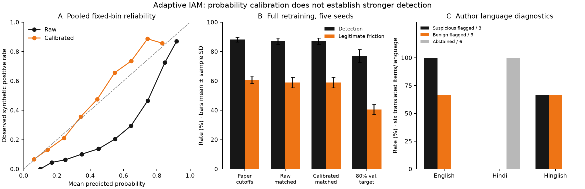

# Adaptive IAM controls reveal evidence boundaries

Adaptive IAM now supplies a stronger research apparatus: verified authentication factors, continuing session enforcement, website onboarding, full retraining controls, an independently generated public sample, multilingual diagnostics and an actual four-validator local chain study. **The clean model gain is probability quality, rather than improved ranking or matched access decisions.** Five complete fits reduce mean Brier loss and fixed-bin calibration error while raw and calibrated controls produce identical decisions. The public sample exposes inadequate takeover labels and an Attack-IP proxy regression; language cases expose Hindi abstention and benign false flags. Four validators demonstrate controlled crash-outage behavior on one host, with no claim of independent administration or measured Byzantine resilience. These results support an honest methods-and-failure-analysis paper; real organizational effectiveness and independent human language evaluation remain pending. ([Retraining protocol](../experiments/risk-protocol.json), [External study](../experiments/external-study.json), [Language diagnostics](../experiments/multilingual-results.json), [Chain study](../experiments/qbft-results.json))

## Verified factors strengthen the implementation boundary

The original proposal now has separate authentication and authorization paths. The API verifies WebAuthn challenges, origin, relying-party ID, user verification and signatures; TOTP enrollment requires a valid authenticator response, and used counters cannot authenticate again. Recovery codes are hashed and single use. Server-observed address and User-Agent changes trigger step-up, and originating-session expiry, logout, revocation or detected risk step-up removes website-token authority. Secure mode rejects public seed passwords and confines an operator-provisioned identity without a factor to enrollment. These are implemented boundaries, not production assurance: first-factor enrollment depends on operator provisioning, context digests are copyable anomaly signals, and software-generated P-256 authenticator tests do not establish physical-browser usability. ([Authentication methods and limitations](../docs/AUTHENTICATION.md), [Identity tests](../backend/tests/test_identity.py))

Organization membership, an app wizard, exact callback checks, confidential-secret rotation and current-session binding make website integration reviewable. They do not establish enterprise tenant isolation or OIDC certification. Resource access still requires server-enforced owner approval and weighted human quorum; neither consent, an NLP label nor an LLM recommendation creates a grant. Access votes remain business decisions and must not become attack labels. ([Developer API](../docs/API.md), [Website integration](../docs/INTEGRATION.md), [Policy implementation](../backend/app/store.py))

## Five complete fits separate calibration from tuning

Seeds **20261020–20261024** each generate 10,000 fresh synthetic events and fit the models from scratch, with 6,000 training, 1,000 calibration, 1,000 selection and 2,000 test rows. This adds training variability beyond the earlier frozen-model bootstrap. A positive-slope sigmoid is retained only when selection Brier loss improves. Raw and calibrated scores receive the same exact validation-score classification tuning and a matched validation detection target; mapping the raw high cutoff through the sigmoid controls block decisions. All settings precede test evaluation, and these runs replace no runtime model. ([Complete protocol](../experiments/risk-protocol.json), [Earlier conditional bootstrap](../experiments/robustness.json))

Across five fits, mean Brier loss falls **0.180707→0.113446** and ten-bin ECE **0.248165→0.021704**. Average precision remains **0.495279**, and matched-control F1 remains **0.462163**. Classification, challenge-or-block and mapped high-risk block decisions are identical in every run. Matched mean detection is 0.869890 and legitimate friction 0.589273 for both representations. Consequently, calibration cannot explain a matched-policy security gain. The fixed paper baseline has F1 0.449909; equal threshold tuning accounts for the increase to 0.462163. Sigmoid monotonicity preserves ranking, while reliability diagrams support evaluating probability estimates separately from decisions. ([Measured means and decisions](../experiments/risk-protocol.json), [Calibration documentation](https://scikit-learn.org/stable/modules/calibration.html), [Guo et al., 2017](https://proceedings.mlr.press/v70/guo17a.html))

The separate 80%-validation detection policy reaches mean test recall **0.770041**, ranging **0.700000–0.814925**, with mean friction 0.405905. A validation target supplies no held-out guarantee. Five-run sample standard deviations and ranges are descriptive simulator results, not population confidence intervals; ECE also depends on binning and sample size. ([Per-run evidence](../experiments/risk-protocol.json))

Figure: pooled fixed-bin reliability, five-fit policy means with descriptive sample standard deviations, and author-labeled language counts. Different panels use different evaluation units. [Vector export](../experiments/figures/validation-controls.svg).

## The public sample reveals a label and transfer gap

The acquired **200,000-row** prefix comes from the RBA creators' synthesized corpus, independently of this project's generator. All feature values remain artificial. CC BY 4.0 attribution and the associated Wiefling study are recorded. Bounded HTTPS ranges retrieved 8,424,171 bytes from the 1,093,700,330-byte archive; the retained sample has its own digest, but full archive checksum and completed CSV-member CRC are explicitly unverified. Prefix sampling is a convenience design. ([Creator provenance](https://github.com/das-group/rba-dataset), [License](https://github.com/das-group/rba-dataset/blob/main/LICENSE), [Acquisition manifest](../experiments/external-data.json))

Only **three takeover-positive rows** occur. Chronological partition positives are 3/0/0/0 and user-disjoint positives 1/0/1/1, so both studies refuse takeover scoring. Separate Attack-IP studies use a threat-intelligence proxy, not confirmed compromise. Chronological held-out F1 increases **0.087257→0.140454**, while user-disjoint F1 regresses **0.155654→0.154626** and recall **0.255284→0.211097**. ROC-AUC stays 0.582818 and 0.503869 respectively; better probability error does not repair weak ranking. Chronological train/test cohorts share 2,033 users; user-disjoint cohorts share none but overlap in time. These are fresh fits, rather than transfer of the deployed model to an organization. ([Eligibility and complete results](../experiments/external-study.json))

Keeping calibrated policy cutoffs at **0.3/0.7 allows every test event in both proxy studies**, giving zero detection and zero friction. This is an explicitly unchanged-cutoff ablation, not deployed policy. A generalized improvement claim would conceal the user-disjoint regression, ineligible takeover task and complete proxy-policy miss. Adequate independent positives, temporal separation combined with user separation, and matched external operating points are still required. ([Ablation and limitations](../experiments/external-study.json))

## Multilingual and chain tests expose distinct limits

The frozen language diagnostic adds **18 author-written translations in six semantic groups**. Runtime flags 5/9 author-suspicious examples and falsely flags 4/9 author-benign examples; every Hindi item abstains, totaling six abstentions. Definite coverage is 12/18, while advisory agreement including abstentions is 7/18. Warm median case latency is approximately 0.75–0.77 ms in the recorded container, excluding initialization. Shared semantics prevent treating these as 18 independent cases. No independent human labels, BERT benefit or threshold retuning is claimed. ([Language artifact](../experiments/multilingual-results.json))

The implemented blind annotation pipeline freezes a digest, requires complete coverage from two distinct named human attestations and a third adjudicator for disagreements, and calculates agreement and pairwise Cohen's kappa. Editable attestations cannot prove identity or independence; actual supervised human collection remains pending. Agreement assesses coding consistency, not verified compromise or authorization truth. ([Annotation protocol](../docs/ANNOTATION.md), [Artstein and Poesio, 2008](https://aclanthology.org/J08-4004/))

The separate chain experiment uses four Besu 26.9.0 validators with distinct keys and an authenticated signer restricted to checkpoint/grant/revoke operations. The API holds no writer key. One stopped validator permits access and a new checkpoint; two stopped validators deny access and new anchors, with height 21 unchanged during a four-second observation. Recovery restores access, and signed revocation denies the former grant. Six sequential confirmations have median **1010.445 ms**, range **769.14–1415.76 ms**. These are confirmation measurements excluding human review, not throughput or production service levels. ([Actual phases and transactions](../experiments/qbft-results.json), [Network runbook](../docs/WEB3_NETWORK.md))

Four containers share one host and administrator. The signer keystore and password co-reside in its volume; this is container isolation, not HSM protection. Access additionally requires three responsive validators agreeing on a recent common block. Writes currently submit through validator 1, whose outage can interrupt writes despite consensus quorum. The study tests crashes rather than adversarial Byzantine validators, independent operators or wide-area behavior. ([Trust and live-authority boundaries](../docs/WEB3_NETWORK.md), [Besu QBFT reference](https://docs.besu-eth.org/private-networks/how-to/configure/consensus/qbft))

## Conclusion

A defensible paper can center on reproducible attribution controls and failure-state enforcement, with measured probability gains beside unchanged decisions and regressions. Its next evidence step needs independently supervised language annotations and adequately labeled organizational outcomes collected under a frozen protocol. Physical-authenticator usability, provider conformance, multi-operator deployment and adversarial consensus testing add different forms of validity; none can be substituted by a synthetic F1 score. Novelty still requires a separate related-work review. Reproduce the new experiments through the [isolated analysis commands](../experiments/README.md) and retain artifact digests with the submission snapshot.
